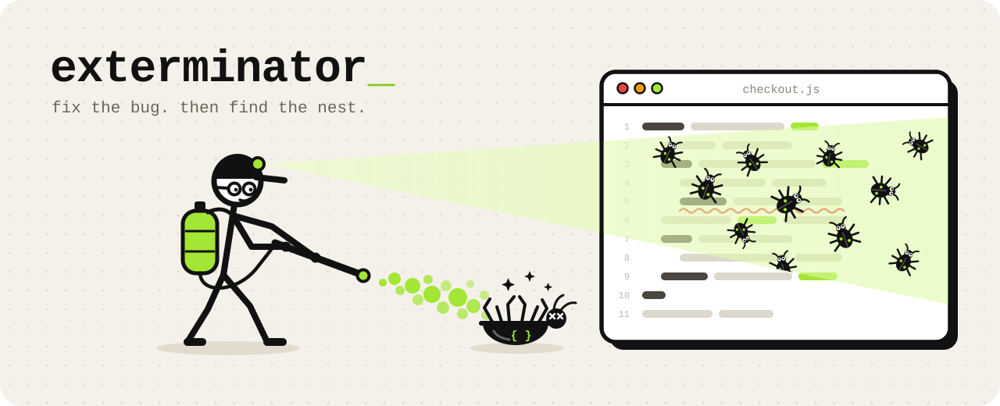

<p align="center">
  
</p>

<p align="center">
  A skill for <b>Claude Code</b> and <b>Codex</b> that fixes bugs at the root cause,<br>then hunts down every other place the same bug lives.
</p>

<p align="center">
  <a href="#claude-code"></a>
  <a href="#codex"></a>
  <a href="lab"></a>
  <a href="LICENSE"></a>
</p>

---

Most agents patch the line that threw, watch the test go green, and move on. But the real cause is usually a wrong assumption or a copy-pasted pattern, and it tends to live in several files at once. Next week it's back with a different stack trace.

`exterminator` reproduces the bug, traces the real cause, finds the siblings, fixes the source, locks it down with a regression test, and explains what happened in plain language.

| A typical fix | With exterminator |
|---|---|
| Patches the line in the stack trace | Traces symptom → proximate cause → root cause, with evidence |
| Stops when the test is green | Hunts the same bug in other files, including ones that don't look alike |
| Sometimes edits the test to pass | Refuses: never weakens tests or swallows errors |
| `pip install` whatever the import says | Checks the package is real before touching it |
| Guesses at a flicker it can't see | Records it, reads a text timeline and one contact sheet, and proves the fix with a before/after capture |
| "Fixed!" | Explains the cause so you learn something |

## Install

### Claude Code

```bash
npx skills add spider12223/exterminator -g -a claude-code -y
```

Or as a plugin, inside Claude Code:

```
/plugin marketplace add spider12223/exterminator
/plugin install exterminator@exterminator
```

### Codex

```bash
npx skills add spider12223/exterminator -g -a codex -y
```

Or as a plugin:

```bash
codex plugin marketplace add spider12223/exterminator
codex plugin add exterminator@exterminator
```

<details>
<summary><b>Manual install, or let the agent do it</b></summary>

<br>

```bash
git clone --depth 1 https://github.com/spider12223/exterminator.git

# Claude Code
mkdir -p ~/.claude/skills && cp -r exterminator/skills/exterminator ~/.claude/skills/

# Codex
mkdir -p ~/.agents/skills && cp -r exterminator/skills/exterminator ~/.agents/skills/
```

On Windows PowerShell, use `Copy-Item -Recurse` with `$HOME\.claude\skills\` or `$HOME\.agents\skills\`.

Or paste this to your agent:

> Install the exterminator skill from https://github.com/spider12223/exterminator (the folder is `skills/exterminator`) into my user-level skills folder.

</details>

## Use it

Report a bug the way you normally would: paste the error, say a test is red, say something stopped working, or describe what looks wrong on screen. The skill triggers on its own. In Codex you can also call it directly with `$exterminator`.

## How it works

```
reproduce ─► cause chain ─► name the bug class ─► hunt siblings ─► verify each one
    ─► fix the source ─► regression test ─► anti-cheat audit ─► report ─► log the pattern
```

It picks the smallest tier that fits, and escalates the moment the cause turns out to be shared:

| Tier | When | What it does |
|---|---|---|
| **T0** trivial | typo, cosmetic, a value you told it to change | fixes it, one-line report |
| **T1** local | wrong logic confined to one function | reproduces, checks callers and copies, adds a test |
| **T2** systemic | shared helper, copied logic, async, config, security, data loss, hallucinated package | the full workflow plus a class-level guard |

### Hard rules

- **Never hides a bug.** No swallowed exceptions, ignore pragmas, special-cased test inputs, or weakened tests.
- **Stops when a test contradicts the intended behaviour.** It reports the conflict and asks which one is right.
- **Stays in scope.** Unrelated problems go under "Also noticed".
- **Asks before big moves.** Refactors, contract changes and new dependencies need your OK.
- **Never installs a package just because the code imports it.** AI-written code invents package names, and attackers register them.

### Visual bugs: bugcam

Flicker, layout jumps, clipped dropdowns and broken animations don't throw errors, and the agent can't watch your screen. It also only sees the first frame of a GIF. So the skill ships `bugcam`, a small camera that records the bug:

- **web pages**, driven through a short scenario in headless Chromium
- **a window or screen region**, for games, desktop apps and Roblox Studio
- **a video, GIF or screenshots** you drop in

It keeps only the frames where something changed, and writes a text timeline plus one contact sheet sized to the model's image budget (about 1.5k tokens). The timeline lists what moved and when, flickers, layout shifts and console errors. After the fix it records the same scenario again, and the before/after comparison goes in the report. Everything stays on your machine.

It's optional. It needs Pillow, plus Playwright with Chromium for web pages, and ffmpeg for screen capture and video files. It never installs anything; if something is missing it prints the exact command. Try it on the demo page:

```bash
python3 skills/exterminator/scripts/bugcam.py doctor
python3 skills/exterminator/scripts/bugcam.py record web --serve tests/fixtures/web --scenario tests/fixtures/web/scenario.json
```

Captures land in `.claude/bugcam/` in your project. Add `.claude/bugcam/` to your `.gitignore` (bugcam never edits it).

### What's inside

```
skills/exterminator/
├── SKILL.md                 the workflow and rules
├── agents/openai.yaml       Codex display metadata
├── scripts/
│   ├── find_variants.py     sibling search: ast-grep → Semgrep → ripgrep → pure Python
│   ├── audit_fix.py         anti-cheat scan of the diff: edited assertions, empty catches, new deps
│   ├── bisect_repro.py      makes `git bisect run` work with any repro command
│   ├── bug_log.py           reads and appends the project's bug-pattern log
│   └── bugcam.py            camera for visual bugs: record, timeline + contact sheet, crop, before/after compare
├── references/              bug classes, debugging, verifying variants, visual debugging, JS/TS, Python, Luau, C/C++
└── assets/                  bug-pattern log template
```

The scripts use only the Python 3 standard library, except the optional `bugcam.py`. On Windows, call `python` instead of `python3`. The bug log lives at `.claude/bug-patterns.md` in your project, whichever agent you use.

## Does it work?

[`lab/`](lab) answers that with numbers. It runs the agent headless against a seeded shop backend in JS, Python, Luau and C, plus a static web storefront, with and without the skill. Then it grades each run with checks the agent never sees.

- **14 tasks.** 11 bug tasks: 8 in the backend and 3 visual ones on the storefront (a layout shift, a flash of the wrong state, a clipped dropdown). Each has one reported bug, 2–3 hidden siblings and 1–2 safe look-alikes. Plus 3 behaviour traps: a test that contradicts the spec, a report that can't be reproduced, and a plain typo.
- **Scored on** whether the reported bug is fixed, sibling recall, look-alikes left alone, whether the root cause is named, and bad-fix flags. The visual checks drive headless Chromium and measure what the browser renders.
- **The grader is tested too.** `python3 lab/grading/selftest.py` runs 45 cases (golden fixes, deliberate cheats, untouched code) through it, with no model calls.

Setup, costs and how to read the scores are in [`lab/README.md`](lab/README.md). The runner drives Claude Code.

bugcam has its own unit tests. Run `python -m unittest discover -s tests` from the repo root. Tests whose tools are missing skip and say why.

## Repo layout

```
.claude-plugin/        Claude Code plugin + marketplace manifests
.codex-plugin/         Codex plugin manifest
.agents/plugins/       Codex marketplace manifest
skills/exterminator/   the skill
lab/                   the eval rig
tests/                 unit tests for bugcam
assets/                banner, icon and social preview
```

## License

[MIT](LICENSE)
